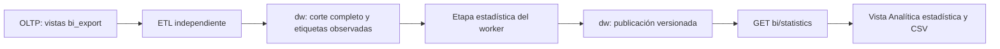

# Plan HITL: analítica estadística del BI

**Fecha:** 2026-10-19. **Rama:** `codex/bi-analitica-estadistica`, base `b0d8cb2`.
**Estado:** plan completado; cinco fases implementadas, verificadas localmente y aprobadas. Sin autorización de despliegue persistente.
**ACK de cierre:** «Continuar», 2026-10-20, después del commit humano `cf801a6`; acepta la fase 5 y cierra la implementación local. Habilitación, migraciones persistentes y despliegue conservan sus procedimientos y autorizaciones específicos.
**ACK fase 5:** «Continuar», 2026-10-20, después del cierre y commit humano `8fada04`; autoriza validación integral y preparación de habilitación con recursos descartables. Conserva los ACK específicos para migraciones persistentes, infraestructura y despliegue.
**ACK fase 4:** «Continuar», después del cierre y commit humano de fase 3; autoriza endpoint/UI/CSV y validación descartable, no despliegue ni fase 5.
**ACK fase 3:** «Continuar», después del cierre de fase 2; autoriza motor y validación descartable, no consumo HTTP/UI ni despliegue.
**ACK fase 2:** «Continuar», después del cierre de fase 1; autoriza datos y validación descartable, no despliegue ni comandos Prisma protegidos.
**ACK de inicio:** «Empieza, recuerda siempre, realiza una fase y terminala detente propon un commit y espera el ack».

## Contexto y Restricciones

- Ejecutar sólo la fase `[Actual]`, entregar evidencia y commit sugerido, detenerse y esperar ACK antes de avanzar, según [AGENTS.md](../../AGENTS.md). No marcar la siguiente fase como actual anticipadamente.
- El checkout inicial está limpio. La fase 1 registra contratos y SQL propuesto: no modifica runtime, activa banderas, aplica DDL ni ejecuta backfills.
- Skills aplicables: inteligencia de negocio y buenas prácticas PostgreSQL; las fases de implementación incorporarán contratos API, TypeScript, testing y frontend según su alcance.
- Preservar migraciones OLTP/DW existentes y sus checksums; `schema.prisma`, infraestructura, package.json raíz, hooks, secretos y despliegue quedan fuera. Migraciones persistentes y comandos Prisma protegidos requieren ACK específico.
- BI actual: worker independiente, reconciliación completa de vistas `bi_export`, snapshots con instante UTC y cabecera incluso vacía, control 0004, publicación atómica con leases/fencing, dashboard sólo `dw` y configuración técnica en `etl`.
- La aceptación previa es local. No hay datos, capacidad ni despliegue productivos verificados que permitan acreditar utilidad predictiva.

## Decisiones confirmadas con el usuario

1. Pronosticar **creaciones observadas**, no inventario ni publicaciones; cada identidad se cuenta una sola vez en su mes UTC de creación. Las altas eliminadas entre cargas pueden faltar.
2. Horizonte: próximo mes calendario. Sin historial/evaluación suficiente se muestra sólo histórico, sin estimación preliminar.
3. Minería con categorías y etiquetas existentes; grupos por reglas estadísticas. Sin texto libre, sentimiento, embeddings o clustering aprendido.
4. Anomalías sobre proporción de rechazados observada, no sobre decisiones nuevas de moderación; valoraciones bajas = rating 1–2, incluyendo todos los estados.
5. Funciones puras TypeScript y SQL en el worker actual, sin nuevos servicios de ML, dependencias o procesos de entrenamiento.
6. Admin/editor consultan su empresa y descargan CSV. Sin nuevos controles de operación ni notificaciones externas.
7. Algoritmo `stats_v1`: promedio móvil 3, evaluación temporal a dos pasos, 12 meses cerrados/90 % de días observados, seis evaluaciones y mejora MAE >=10 % sobre último valor. Anomalías: mediana/MAD, ventana 28 días, >=21 cortes válidos y n>=30, incremento mínimo 5 puntos porcentuales.

## Entregables canónicos de fase 1

- [Contrato, catálogo de métricas y aceptación](../modules/api-bi-statistics.md), versión propuesta 1. Incluye temporalidad, límites, transporte y tratamiento de errores/ausencias.
- [SQL OLTP propuesto](2026-10-19_feat-bi-analitica-estadistica_oltp-borrador.sql): dos vistas de etiquetas, sin nuevas columnas/modelos operacionales.
- [SQL DW propuesto](2026-10-19_feat-bi-analitica-estadistica_warehouse-borrador.sql): staging, taxonomía, primeras observaciones, tareas e informes. Se promoverá a la siguiente migración libre, inicialmente `0005_bi_statistics.sql`, únicamente en fase 2.
- Enlaces de evolución propuesta en contratos backend/web y diccionario DW; el contexto mantiene explícita la ausencia de runtime nuevo.

## Acoplamiento y límites



La etapa estadística empieza después de cerrar origen y publicar ETL. No modifica el éxito de esa carga. Sus tareas usan presupuesto/reserva separados; el API no calcula ni escribe resultados. El scheduler prioriza ETL y procesa como máximo una tarea estadística por tick después de las cargas elegibles. Un fallo conserva la última publicación, identificada como anterior cuando corresponda.

`BI_STATISTICS_ENABLED=false` por defecto en API/worker; sin ella no se consultan objetos nuevos. Una activación requiere verificar previamente vistas, esquema, permisos y software compatibles. La ausencia de objetos estadísticos no cambia requisitos del CMS ni del resumen existente; la etapa opcional falla de forma aislada. No cambia frecuencia ETL 1/6/24h ni sus límites de cinco minutos, una conexión fuente y dos destino.

## Fases HITL

### `[Completada]` 1. Contratos y diseño — aprobada

- [x] Registrar decisiones, dependencias y restricciones, sin ampliar autorizaciones.
- [x] Fijar catálogo, fórmulas, cobertura, disponibilidad, tipos/endpoint y aceptación.
- [x] Preparar SQL separado de migraciones ejecutables, claves compuestas y matriz de permisos.
- [x] Validar estáticamente formatos, referencias locales, gramática admitida por el migrador y alcance del diff. Esta validación no acredita ejecución PostgreSQL.

### `[Completada]` 2. Datos — aprobada

- [x] Promover borradores revisados a migraciones aditivas; mantener checksums anteriores. Verificar mantenimiento y precondición 0004 desde el migrador.
- [x] Incorporar tags/relaciones a tipos, extracción y staging dentro de la transacción fuente existente; conciliar conteos y relaciones sin fan-out.
- [x] Publicar marcador de cobertura de etiquetas incluso vacío y puente con el snapshot. Actualizar primeras observaciones en la misma publicación.
- [x] Preparar backfill explícito y reanudable de primeras observaciones desde cortes reales; nunca inferir etiquetas históricas. Detectar discrepancias de `created_at` por identidad, sin elegir silenciosamente una fecha.
- [x] Validar migraciones, backfill, permisos, replay, vacíos, borrados y atomicidad en PostgreSQL descartable; no usar comandos protegidos sin su autorización específica.

### `[Completada]` 3. Motor estadístico — aprobada

- [x] Implementar funciones puras con oráculos independientes antes del código de producción, incluyendo casos frontera del contrato.
- [x] Construir entradas agregadas acotadas en lectura DW consistente; evaluación por origen sin fuga de información.
- [x] Integrar cola recuperable, presupuesto 3, lease90s/heartbeat20s/deadline60s y publicación ACID independiente. Priorizar ETL; no reclamar tareas obsoletas.
- [x] Probar pérdida de lease, reinicios, dos workers, respuesta ambigua tras commit, fallos y puntero monotónico.

### `[Completada]` 4. Consumo — aprobada

- [x] Incorporar bandera, GET privado con DTO estricto, cuota y validación de publicación; conservar permisos admin/editor por tenant.
- [x] Agregar `view=statistics` en la navegación BI, adaptador Zod, tres secciones con tablas/gráficos y CSV desde la respuesta autorizada visible.
- [x] Actualización al entrar/volver/solicitarla; no agregar polling continuo. Limpiar datos al cambiar sesión y descartar respuestas obsoletas.
- [x] Probar filtros ajenos rechazados, roles, vigencia, calendario, accesibilidad y CSV equivalente/neutralizado.

### `[Completada]` 5. Validación integral — aprobada

- [x] Recorrido real con dos tenants, API/worker/OLTP/DW descartables, fallos y restauración de nuevos objetos/permisos.
- [x] Medir costo de extracción de etiquetas, cálculo, consultas y CMS con/sin ampliación sobre recursos/dataset declarados. ETL <=5min; estadística <=60s; lectura SQL5s/tx10s. Registrar p95/p99, errores y crecimiento; no certificar capacidad productiva con fixtures.
- [x] Preparar runbook de mantenimiento, promoción, flags y recuperación. Deshabilitar consumo/cálculo conserva datos; rollback de software no implica DROP.
- [x] Clasificar evidencia como verificada, pendiente o no aplicable. Desempeño predictivo con historial real y SLO del destino siguen pendientes hasta tener evidencia; no habilitar por aprobar pruebas sintéticas.

## Evidencia y cierre de fase 1

Entregados los documentos y borradores enlazados. Sólo se ejecutan controles locales de formato, referencias y análisis estático del SQL; no se aplican migraciones, crean bases ni habilitan funciones. El detalle de los controles efectivamente ejecutados se registra al cerrar esta fase.

- **Verificado:** Prettier en plan/contrato nuevos y contrato web enlazado; `git diff --check`; 13 referencias locales/anclas introducidas; sintaxis TypeScript del bloque documental con el parser instalado.
- **Verificado:** tokenizador `migrationStatements` vigente acepta 5 sentencias del borrador OLTP y 23 del DW; 48 nombres de constraints/índices DW únicos y dentro del límite de63 bytes (ASCII). No se ejecutó el migrador ni se abrió conexión a base de datos.
- **Verificado:** 18 archivos existentes de migración sin diferencias contra HEAD; sin cambios en runtime API/web, Prisma, infraestructura, raíz npm, hooks, skills o AGENTS.
- **Conservado:** backend BI y diccionario DW ya tienen formato no conforme a Prettier en HEAD; las dos inserciones de enlaces no reformatean esos documentos. Ambos siguen con el mismo diagnóstico previo.
- **Pendiente:** sintaxis y constraints efectivos en PostgreSQL18, planes de consulta, permisos reales, backfill, cálculos, endpoint y UI. Un tokenizador no verifica estos comportamientos. Corresponden a fases posteriores, cada una con su ACK.

**Commit sugerido:** `docs(bi): definí la ampliación de analítica estadística`

**Detención de fase 1 cumplida:** ACK «Continuar» recibido antes de fase 2. No autoriza ejecutar fases 2–5 en conjunto.

## Evidencia y cierre de fase 2

- **Implementado:** nueva migración OLTP `20261019000000_bi_statistics_export` con dos vistas y DW `0005_bi_statistics.sql` con diez tablas. La 0005 exige 0004 y mantenimiento sin runs/reservas. Los 18 archivos previos de migración permanecen intactos, al igual que sus entradas/checksums verificados en pruebas.
- **Implementado:** extracción paginada de etiquetas y relaciones dentro del snapshot RR del origen; conteos BigInt independientes. Publicación y conciliación atómicas de taxonomía, puente, creaciones y marcador de historial dentro del fencing ETL. Un cambio de fecha de creación o conteo incorrecto revierte el corte completo.
- **Implementado:** `StatisticsHistoryRepository` y CLI manual `--check` / `--apply --maintenance`, con identidad migradora, tandas de hasta1000, mantenimiento, validación temporal previa/final, interrupción/replay y marcador sólo al completar. Incluye empresas vacías y conserva identidades eliminadas observadas; no inventa etiquetas históricas.
- **Compatibilidad:** preflight opt-in de datos verifica esquema/SELECT/DML/historial al iniciar el worker. Defaultfalse no consulta objetos nuevos; fallo opcional mantiene el worker base y emite código seguro. La bandera del worker se preparó en fase2 porque controla la extracción nueva; la habilitación HTTP/UI sigue reservada a fase4. Sin cálculos, tareas activas, endpoint ni frontend nuevos.
- **Verificado:** dos PostgreSQL18.6 locales independientes, bases y roles aleatorios restringidos. **22 pruebas nuevas** (18 integración/4 unitarias) aprobadas, sin omisiones: migración/replay/drift/mantenimiento, aislamiento y permisos efectivos, fuente RR con mutación concurrente, vacíos/ausencias, borrados, fechas inconsistentes, backfill interrumpido y retomado, totales falsos, rollback tras perder fence y recuperación con escritor anterior.
- **Regresión:** corrida amplia **183/183 casos en14 suites**; después de ajustes de permisos/validación, **58/58 casos afectados en4 suites**; tras el último caso de compatibilidad, **22/22 nuevos en2 suites**. No son cantidades sumables. Red funcional del extractor observado antes de implementarlo: el caso nuevo falló por ausencia de entrega de tags; Green posterior. No se afirma ejecutar toda la suite del CMS ni E2E de fase5.
- **Verificado:** typecheck, build y lint API; lint conserva tres advertencias ajenas al cambio en idempotency/public-testimonials/setup. `git diff --check` y formato documental sin problemas. Sin cambios en Prisma schema, infraestructura, raíz npm, hooks, skills, AGENTS o web.
- **Operación:** [guía de datos/backfill](../operations/28_bi_statistics_data.md), contratos y diccionario actualizados. La prueba de compatibilidad acredita eliminación de enlaces temporales por cascada al recuperar con modo anterior; pueden quedar labels de staging que requieren saneamiento de mantenimiento, explicado en la guía.
- **Limpieza verificada:** cero bases/roles de las pruebas remanentes en ambos servidores antes de apagarlos; PostgreSQL temporales detenidos y directorio propio eliminado. No se ejecutaron `prisma migrate deploy`/`db push`, migraciones persistentes, despliegue ni commit automático.
- **Pendiente:** motor estadístico y tareas recuperables (fase3), API/UI/CSV (fase4), aceptación integral/restauración/capacidad y adaptadores remotos de permisos/habilitación (fase5). Utilidad predictiva con historial real no acreditada.

**Commit sugerido:** `feat(bi): incorporá etiquetas e historial observado al ETL`

**Detención de fase 2 cumplida:** ACK «Continuar» recibido antes de fase 3. No autoriza consumo ni despliegue.

## Evidencia y cierre de fase 3

- **Implementado:** funciones puras `stats_v1` para media3 constante h2, cobertura y seis orígenes, MAE/sesgo, frecuencias, segmentos, asociaciones y señales de mediana/MAD. Promoción predictiva y filtros de soporte/lift con productos enteros exactos; decimales antes de convertir magnitudes a Number. Histórico/razón de indisponibilidad conservados, sin bandas inventadas.
- **Implementado:** lectura única DW RR READ ONLY UTC; origen de cada fold excluye identidades descubiertas después. Agregados acotados a24 meses, seis orígenes,50 grupos por lista,1225 pares y118 días fuente; no materializa textos ni inventarios completos en Node. Cálculo después de cerrar la transacción de lectura.
- **Implementado:** descubrimiento idempotente posterior al ETL que repara caídas antes del encolado; claim por tenant con token, presupuesto3, lease90s, heartbeat20s y deadline60s. Recuperación tras expiración, pendientes obsoletas superseded y drenaje ante apagado. Publicación de informe/puntero/éxito ACID con fencing y procedencia; replay y respuesta ambigua post-commit sin duplicados ni retroceso.
- **Compatibilidad:** CLI prioriza cargas ETL y procesa una tarea estadística por ciclo; preflight opcional de permisos del motor separado del de datos. Bandera apagada no consulta objetos nuevos. Fallo estadístico conserva ETL exitoso y publicación anterior; logs acotados sin nombres/filas/conexiones. Sin endpoint, frontend, migraciones adicionales ni dependencias nuevas.
- **Verificado:** **52 casos agregados en fase3**,31 motor/6 servicio/14 persistencia/1 CLI real. Oráculos fijados previamente: mediana par, media120, MAE y sesgo, soporte0,1/confianzas0,25 y0,5/lift1,25; casos cero, baseline perfecto, mejora10% exacta con tercios, bisiesto, meses parciales y cortes ausentes. Dos tenants/roles restringidos, dos claims concurrentes, tres intentos, renovación/vencimiento de lease, rollback por deadline/permisos, payload inválido, fuente incorrecta y recuperación de respuesta perdida tras commit.
- **Regresión final:** **239/239 casos en17 suites**, sin omisiones, sobre dos PostgreSQL18.6 locales descartables. Incluye las cinco suites estadísticas y las doce suites previas de PostgreSQL/worker/tiempo/operación/HTTP/ETL/scheduler/dashboard. Las ejecuciones parciales anteriores no se suman a este total. Red funcional de los oráculos de mediana/asociación constatado antes de implementarlos; una falla inicial de integración por deserialización de `void` del lock se corrigió usando executeRaw, conservando las assertions.
- **Verificado:** `npm run typecheck --workspace apps/api`, `npm run lint --workspace apps/api` y `npm run build --workspace apps/api`. Lint: cero errores y las mismas tres advertencias previas en idempotency/public-testimonials/setup. No se ejecutó la suite completa del CMS ni E2E; performance/restauración integral corresponden a fase5.
- **Documentado:** [operación del motor](../operations/29_bi_statistics_worker.md), grants mínimos, recuperación, comportamiento de `--once`, falta de interrupción preventiva del cálculo síncrono y límites de evidencia. Contratos y contexto actualizados sin presentar HTTP/UI como implementados.
- **Control final:** `git diff --check`, Prettier de los cuatro documentos nuevos/actualizados de plan/contrato/operación y20 referencias locales válidas. Migraciones OLTP/DW, Prisma schema, infraestructura, raíz npm, hooks y web sin cambios en esta fase. Cero bases/roles de fixtures remanentes en ambos servidores; PostgreSQL propios detenidos y directorio temporal eliminado.
- **Pendiente:** API/UI/CSV de fase4; restauración integral, benchmarks y preparación de habilitación/permisos remotos de fase5. Fixtures sintéticos no acreditan utilidad predictiva real. Sin aplicación persistente, despliegue ni commit automático.

Comando de regresión, con `TEST_BI_SOURCE_DATABASE_URL` y `TEST_BI_WAREHOUSE_DATABASE_URL` apuntando exclusivamente a los servidores descartables de prueba:

```bash
npm test --workspace apps/api -- --runTestsByPath \
  test/bi-statistics-data.integration.spec.ts test/bi-statistics-source.spec.ts \
  test/bi-statistics-worker.integration.spec.ts test/bi-statistics-engine.spec.ts \
  test/bi-statistics-service.spec.ts test/bi-postgres.integration.spec.ts \
  test/bi-worker.integration.spec.ts test/bi-snapshot-time.integration.spec.ts \
  test/bi-operations.integration.spec.ts test/bi-operations-http.integration.spec.ts \
  test/bi-http.integration.spec.ts test/bi-etl.spec.ts test/bi-snapshot-time.spec.ts \
  test/bi-scheduler.spec.ts test/bi-operations.spec.ts \
  test/bi-operations-policy.spec.ts test/bi-dashboard.spec.ts
```

**Commit sugerido:** `feat(bi): incorporá el motor estadístico y sus tareas recuperables`

**Detención de fase 3 cumplida:** ACK «Continuar» recibido después del commit humano `046202e` y antes de fase4. No autoriza validación integral ni despliegue.

## Evidencia y cierre de fase 4

- **Implementado:** `GET /api/v1/bi/statistics` con JWT/RBAC admin/editor antes de flags/conexión, tenant de sesión, DTO query vacío estricto, cuota120/min y middleware privado también en errores. Opt-in API `BI_STATISTICS_ENABLED` independiente del worker, defaultfalse, sin readiness ni conexión adicional. No se ejecutan cálculos ni escrituras desde HTTP.
- **Implementado:** repositorio lee sólo DW en transacción RR READ ONLY UTC mediante conexión vigente; última cabecera, puntero/publicación, reloj e inicios de cobertura consistentes. Valida JSON `stats_v1` y ancla fuente antes de presentar; metadatos relacionales son autoridad. Preferencias de vigencia usan servicio existente, sin leer jobs ni crear controles nuevos.
- **Implementado:** estados not_loaded/pending/current/outdated, cantidades desconocidas NULL frente a cero observado, antigüedad desde corte y tolerancia configurada. Retiro de proyección ante informe anterior/stale, con precedencia de TARGET_OUTDATED al cambiar mes; conserva histórico/evaluación/patrones/señales. Errores técnicos y JSON inválido =>503 seguro, sin falso resultado vacío ni fallback OLTP.
- **Implementado:** `view=statistics` para admin/editor; navegación elimina filtros heredados y explica ventanas propias. Gráficos/tablas de pronóstico, frecuencias/segmentos/pares y señales con leyendas, períodos, versión, cobertura y vigencia; diferencias entre observado/estimado y datos faltantes. Reutiliza sesión, remount por identidad, abortos, retorno a pestaña y botón, sin polling ni lectura de estado operativo en esta vista.
- **Implementado:** tres CSV independientes con metadatos/estado/motivo, histórico/evaluación/métricas, patrones/cobertura y180 señales. Conteos exactos, porcentajes de transporte expresados como porcentaje, NULL vacío y cero literal; BOM UTF8/CRLF/escape/neutralización de fórmulas. Descargas bloqueadas sin publicación, en actualización o tras error.
- **Verificado:**16 casos backend nuevos:4 de presentación,9 HTTP y3 lecturas DW con permisos restringidos. JWT/RBAC/middleware/cuota reales salvo dependencias simuladas de identidad/cuota; dos tenants, query ajena, flags off sin servicio,401/403/400/429/503 privados, ausencia/vigencia/cambio de mes, JSON inválido y permisos faltantes aislados del inventario base. Red funcional de presentación constatado con cuatro assertions fallidas antes de implementar; el intento inicial sin módulo aún no era Red funcional.
- **Regresión final backend:** **255/255 casos en19 suites**, sin omisiones, con dos PostgreSQL18.6 descartables. El primer intento detectó un fixture inválido ya bloqueado por CHECK de DW; se cambió a JSON con estructura válida y valor incompatible, sin relajar restricciones. Repetición afectada17/17 y regresión final completa aprobadas; cantidades no sumables.
- **Verificado web:**18 casos nuevos (10 contrato/CSV,6 vista/gráfico,2 sesión/navegación); **96/96 en9 archivos BI**. Casos: carga/pendiente, desconocidos, insuficiencia, falta de etiquetas/pares, antigüedad, errores/limpieza, teclado, respuestas tardías de otra sesión y refresh explícito. Tras aclarar edad del corte y denominador del mes parcial, se repitieron los5 casos de vista. La revisión independiente detectó escala vertical y separación temporal incorrectas del gráfico mensual: una nueva prueba falló con las coordenadas previas y pasó tras alinear el máximo al eje y dejar un intervalo hasta el próximo mes. No se ejecutó toda la suite web/CMS ni E2E integral de fase5.
- **Verificado navegador:** Chrome local en1440×1000 y390×844, API/sesión sintéticas: cero desborde horizontal de página, tablas con scroll local, detalle de90 días accesible y CSV de patrones descargado/equivalente (soporte10/confianzas25 y50/lift1,25). Cero consultas operativas desde estadísticas; lectura manual posterior confirmada. StrictMode de desarrollo hizo dos lecturas iniciales; no es prueba de una tasa productiva. El ejecutable agent-browser no estaba instalado; se usó Playwright con Chrome ya instalado. Detector de UI ejecutado una vez, sin hallazgos mecánicos.
- **Revisión independiente:** preservación del sistema visual y correspondencia documental comprobadas por las pasadas de UI/documentación previstas en la skill de interfaz. Tras corregir escala y separación mensual, el reviewer calificó ambos hallazgos como resueltos y emitió `ship` exclusivamente para esa pasada; no certifica accesibilidad universal ni integración real.
- **Documentado:** [consumo, permisos y límites](../operations/30_bi_statistics_consumption.md), contratos API/web y contexto. Sin migraciones nuevas ni cambios a Prisma schema, infraestructura, raíz npm, hooks, dependencias o despliegue. Gráficos y tablas revisados bajo el sistema visual vigente, sin rediseñarlo.
- **Controles finales:** typecheck, lint y build API/web aprobados. Lint conserva tres warnings API y ocho web previos al cambio; ningún error nuevo. Build web final incluye la corrección geométrica. `git diff --check`, formato de seis documentos de contrato/operación/plan y33 referencias locales válidas. Cero bases/roles de fixtures remanentes en ambos PostgreSQL antes de apagarlos; Next de prueba y navegador cerrados, directorio temporal propio eliminado. No se ejecutó commit automático.
- **Pendiente:** fase5 con su ACK para aceptación integral, restauración, rendimiento y adaptadores remotos de grants/habilitación; autorizaciones específicas para migraciones persistentes/despliegue. Los fixtures no acreditan utilidad predictiva ni capacidad real.

Regresión backend: comando de fase3 con las dos suites adicionales `test/bi-statistics-read.spec.ts` y `test/bi-statistics-http.integration.spec.ts`. Regresión web: `npm test --workspace apps/web -- src/features/business-intelligence`.

**Commit sugerido:** `feat(bi): agregá la vista estadística y su API privada`

**Detención de fase 4 cumplida:** ACK «Continuar» recibido después del commit humano `8fada04` y antes de fase5. No autoriza migraciones persistentes ni despliegue.

## Evidencia y cierre de fase 5

- **Verificado:** seis casos nuevos de integración completa con AppModule, JWT/RBAC, Redis real, CLI independiente y dos PostgreSQL 18.6 descartables; dos tenants con 100 testimonios y 60 asignaciones cada uno. Admin/editor reciben sólo su empresa; query ajena se rechaza. Fallo estadístico tres veces conserva éxito ETL e informe anterior; caída del lector devuelve error privado sin impedir readiness, listado, captura ni moderación. Flag apagada conserva dashboard e informes.
- **Verificado:** backup/restauración de las 30 tablas de DW/staging/control, con cantidades y digest iguales, ledger y ACL. Tarea pendiente recuperada desde otra base vacía mediante CLI restringida, sin duplicados al repetir barrido. Denegaciones de lector/control y de UPDATE/DELETE de informes/creaciones comprobadas antes y después de restaurar. Roles ya existentes en el mismo cluster; no acredita PITR, recuperación entre clusters ni RTO/RPO remoto.
- **Corrección comprobada:** benchmark inicial con 50 etiquetas por testimonio agotó SQL30s en asociaciones, después de ETL exitoso. La consulta agrupa conjuntos idénticos de etiquetas y expande pares con su peso, preservando conteos, orden, top50, umbrales y `stats_v1`. Oráculo adicional de 100 testimonios/50 etiquetas: 1225 pares, conteos y marginales100, lift1 y ninguna asociación destacada. No se amplió el plazo ni se redujo la carga para ocultar el fallo.
- **Rendimiento local:** 425 cortes históricos, 217170 detalles, 1001 testimonios actuales y 50050 relaciones. ETL final encendido 21138ms, tarea estadística 567ms; cumplen límites de cinco minutos/60s en esta muestra. CMS concurrente p95/p99 pasa de66,1/67,3ms a148,9/150,8ms, con40/40 y60/60 respuestas200. El reporte conserva costo de extracción/publicación, tamaño y CPU/RSS de API. Mismo host, orden apagado/encendido, caché calentada y20 muestras por ruta; modo encendido agrega lectura estadística. No aísla causalidad ni certifica SLO/capacidad productiva. [Resultados y límites](../operations/31_bi_statistics_validation_and_rollout.md), [fallo inicial](../technical/bi-statistics-benchmark-initial-2026-10-20.json), [comparación final](../technical/bi-statistics-benchmark-2026-10-20.json).
- **Verificado navegador real:** Next compilado servido mediante `next start`, API/Redis/worker/PG reales, sin interceptar HTTP. Admin solicita carga, cierra sesión; editor móvil recupera publicación; otra empresa queda sin corte/descarga; nueva sesión admin recupera solicitud exitosa. Chrome1440×1000 y390×844 sin desborde de página, tabla de90 días visible. Tres CSV contra el mismo corte:25 filas pronóstico/histórico,12 patrones y180 señales; par10/soporte10/confianzas25 y50/lift1,25 y fórmula neutralizada. Los primeros intentos detectaron que el selector del test elegía «Sin categoría»; se corrigió el selector a la categoría sintética esperada, sin modificar producto ni su protección CSV. [Evidencia](../technical/bi-statistics-browser-2026-10-20.json). No acredita empaquetado standalone/TLS/ingress productivo, otros motores ni auditoría WCAG universal; agent-browser no estaba instalado y se usó Playwright/Chrome disponibles.
- **Preparado y verificado localmente:** SQL aditivos mínimos OLTP/DW, catálogo de preflight opcional y validación de flags sin conexiones nuevas. Encendido exige mínimos y ledger0005; apagado permite conservar esos grants sin exigirlos ni tolerar privilegios extra. Prueba nativa aplica propuestas en bases propias con propietarios distintos y verifica cinco identidades; TLS local deliberadamente ausente es la única incidencia esperada, sin relajar preflight remoto. Adaptador/workflow manual mantienen0004 por defecto;0005 exige bandera específica y confirmación adicional `statistics`. No se ejecutó ningún workflow/migración persistente. Red funcional observado para banderas y selección de destino antes de la corrección;67/67 tests nativos y una prueba nativa adicional de permisos aprobados, análisis estático de workflows aprobado.
- **Regresión final:** **267/267 casos backend en21 suites BI**, sin omisiones, y **96/96 web en9 archivos BI**. La primera corrida conjunta detectó cuotas de login compartidas en Redis; se corrigió el aislamiento de fixtures reservando una base lógica vacía por instancia y limpiando sólo la propia, conservando cuotas/guardias reales. Corrida final completa aprobada. Typecheck, lint y build API/web aprobados; tres warnings backend y ocho web previos al cambio. No se afirma ejecutar toda la suite CMS ni CI remoto.
- **Documentado:** runbook de promoción, backfill, grants, activación worker antes de API, observación y recuperación/apagado sin DROP; contratos API/web, guías previas, AGENTS y llm actualizados. No cambiaron schema Prisma, migraciones/checksums existentes, infraestructura, package.json raíz, lockfile ni hooks.
- **Limpieza verificada:** cero bases/roles de fixtures en ambos PostgreSQL y cero reservas Redis antes de detenerlos. API/worker de navegador y Next cerrados; servicios temporales detenidos y directorio propio retirado. Sin secretos/PII reales en evidencia, commit automático, migración persistente ni despliegue.
- **Pendiente fuera de la implementación local:** verificación de CI de la entrega; provisión y preflight conectados del destino, TLS/Data API/ingress, SLO/CPU/IO/pools/capacidad y restauración real; datos suficientes y utilidad predictiva por empresa. Los datos sintéticos sólo acreditan mecánica. **No aplicable en esta entrega:** entrenamiento/servicios ML, texto libre, causalidad/significancia, intervalos predictivos sin cobertura, notificaciones y captura durable de todas las altas, fuera del alcance acordado.

Reproducción, scripts opt-in y restricciones del entorno en la [guía de fase 5](../operations/31_bi_statistics_validation_and_rollout.md).

**Commit sugerido:** `test(bi): validá la analítica estadística y su recuperación`

**Detención de fase 5 cumplida:** ACK «Continuar» recibido después del commit humano `cf801a6`. Las cinco fases quedan cerradas; no hay otra fase de implementación pendiente en este plan. El cierre no autoriza migraciones persistentes, habilitación ni despliegue.

**Commit sugerido para registrar el cierre:** `docs(bi): registrá el cierre aprobado de la analítica estadística`
